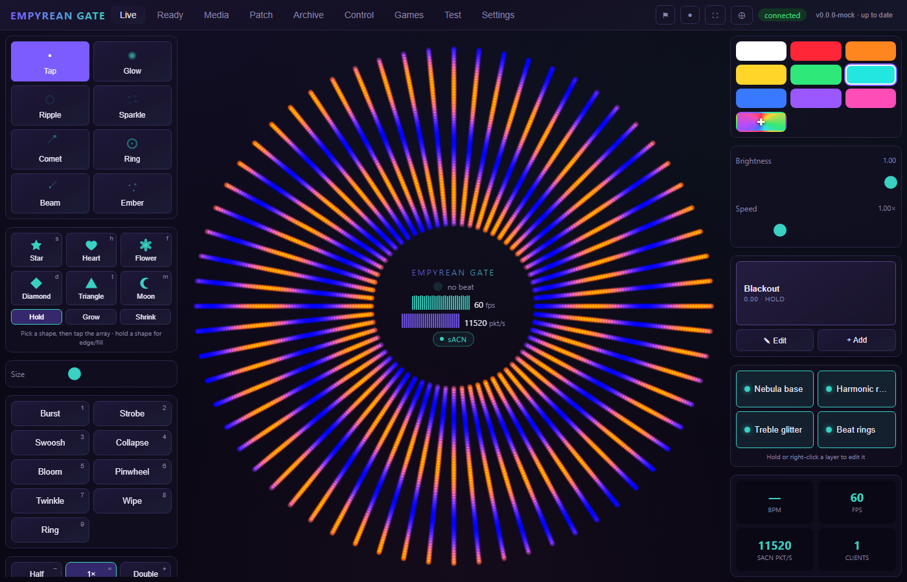
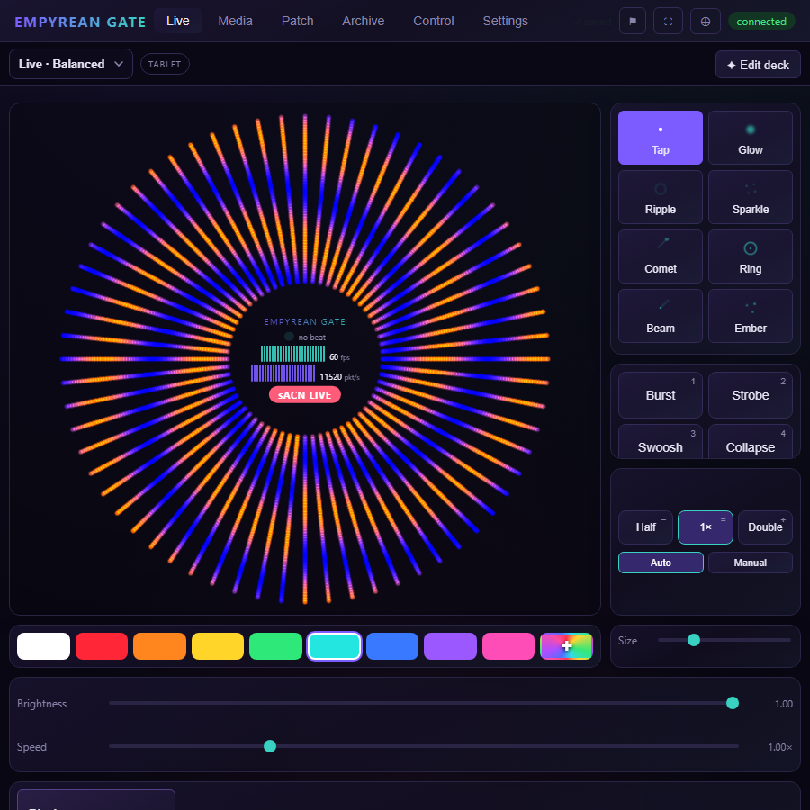
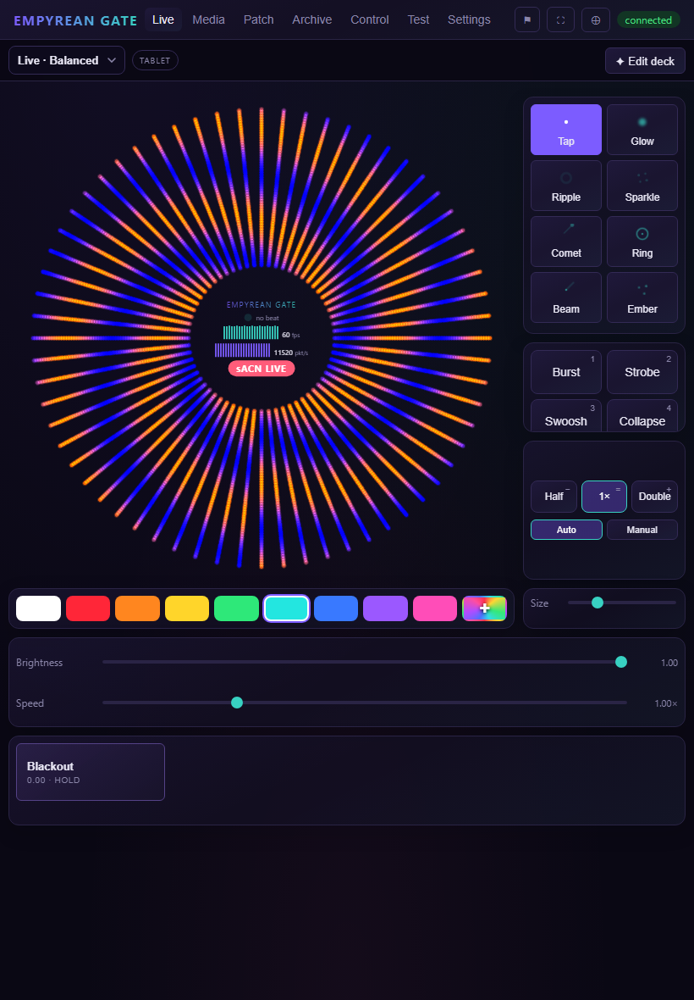
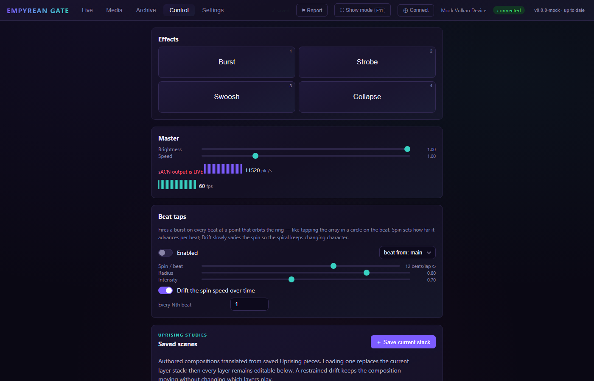
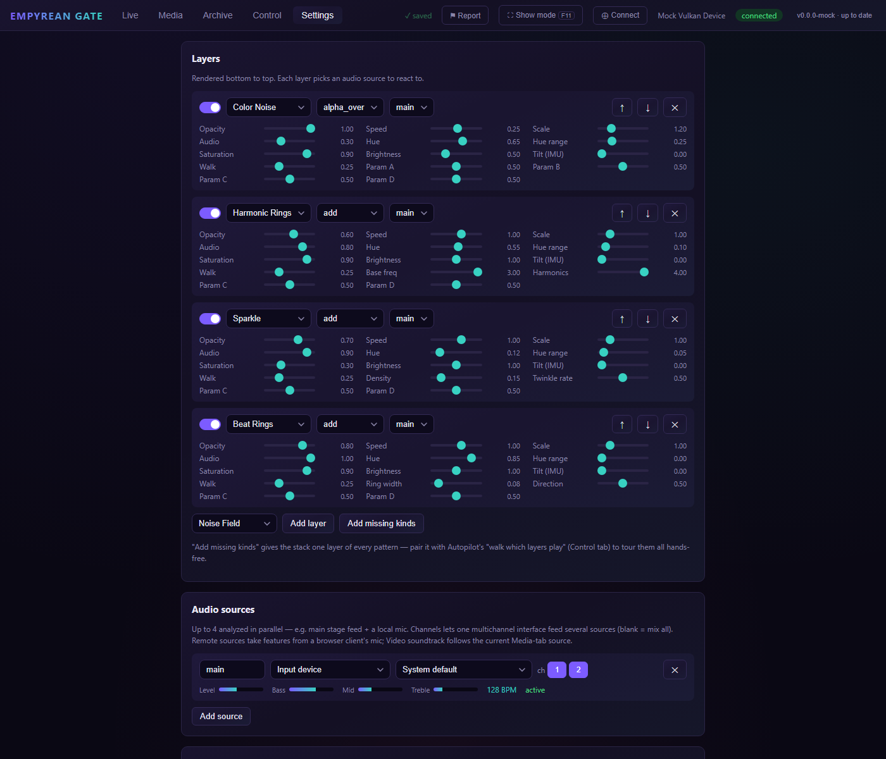
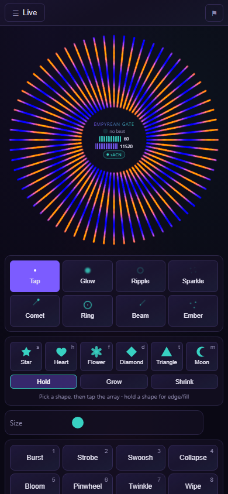
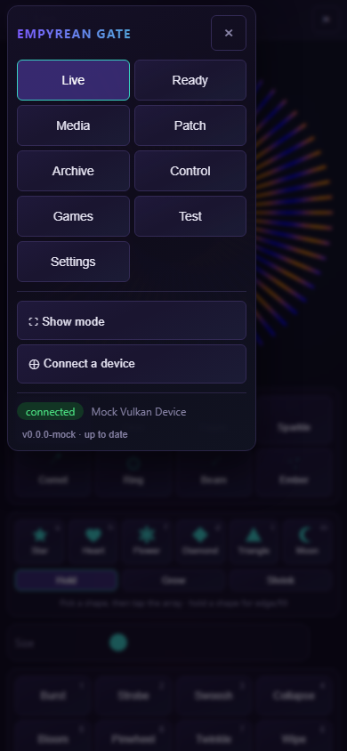

# Empyrean Gate

GPU pattern generator and sACN pixel driver for the **Empyrean Gate** — a radial array
of lights above a dance floor: 64 spokes of LED strip (378 px each, fed from the
outside) in a 50 ft diameter ring, driven by 16× Advatek PixLite Mk4-S controllers over
sACN (E1.31).

Every frame is computed from scratch on the GPU (wgpu locked to **Vulkan** — no
fallback renderers, just clear errors), read back, and scattered into prebuilt sACN
packets with zero steady-state allocations. Audio from the DJ (multiple parallel
sources) drives the patterns via beat tracking and band energies.

## Screenshots



| Squarish window — corner controls | Tablet / portrait | Control | Settings |
|---|---|---|---|
|  |  |  |  |

| Phone — array on top, controls below | Phone — the corner menu |
|---|---|
|  |  |

The Live surface adapts to the window: the array view stays as large as possible and
the controls flow into whatever space is left — side columns, top/bottom bars, or the
corners the circle never reaches. The empty ring center carries the title, beat, and
live meters. The columns reflow into more sub-columns as the leftover space grows, so
an ultrawide show display shows everything at once. Where the window genuinely has no
room — a squarish aux window, a portrait tablet — the secondary controls (master,
quick settings, layers, status) fold behind an **All controls** sheet rather than
taking size away from the array. The whole thing is chosen by CSS aspect-ratio media
queries, so it is correct at first paint with nothing to arrange or maintain.

**Show mode** (⛶ in the top bar, or F11) takes the native window fullscreen so the
array fills the display; Esc or the same top-bar button brings it back. Nothing floats
over the array — the top bar stays, and it already carries Report, Record and the
update control, so no pill can land on top of Live's corner clusters.
The state persists, so the app reopens the way it was closed — including across
self-updates.

**On a phone** the top bar is one row: a ☰ corner menu naming the current tab, and
Report. The tabs and every other top-bar action — show mode, connect a device, new
window, the connection state, the version chip — live inside that menu, which is a
row of chrome the array gets back and, more to the point, the only way those controls
are reachable at that width. Live is a scrolling column there: a drag on the array
draws (it swallows pan gestures), a drag anywhere else scrolls to the controls below.

## Architecture

- **Backend is the app.** Frame generation runs on a dedicated thread:
  GPU compute → readback (ping-pong staging, no stalls) → sACN + preview fan-out.
  Kill every UI and the lights keep running. In the desktop app, closing an
  *extra* window (main or popped-out) never asks anything; only the **last**
  window, while sACN is transmitting, gets the "the show is live" confirmation.
  And after that last close the wire goes dark as promised, but the engine keeps
  rendering for 30 s behind a small **"If that was a mistake… Restart the show
  ASAP"** window — one tap brings the main window back and the output fades up
  where it left off; "Stop now" or the timer ends the process.
- **Know when the engine is behind.** Beside fps and packets-per-second, the
  Live ring and Control meters carry a **load** sparkline: the share of each
  second the GPU dispatch + readback actually took (one number for GPU and CPU,
  because the frame loop is one thread; it passes 100 % when frames overrun).
  When load stays over budget or frames stay starved for several seconds in a
  row the engine raises a warning and every UI shows a dismissible **"The
  engine is behind"** toast with the three cheapest load-shedding moves: cap
  phone previews at 15 fps (applies to streams already running), pause the
  off-air Ready bus (a whole second render per frame), or render at 45 fps.
  All three are ordinary settings, so they undo in Settings / on the Ready tab.
  On Windows the backend also watches the **display topology** (monitor count,
  primary size): every change is logged, counted, and shown as a banner naming
  it — and several changes in a few minutes turns the banner red as a **flapping
  cable**, because a USB-C/HDMI link going in and out resets the GPU driver and
  stalls the show ~0.5 s each time (seen live). The app cannot refuse a
  hot-plug; it can say what is happening and that pulling the extra display is
  the fix. GPU re-inits are counted alongside. It also reads each monitor's
  **link health** offline — the mode the panel asks for (its EDID, from the
  registry) against the largest mode Windows will offer — and banners a monitor
  negotiated below native, which is what a USB-C DisplayPort cable running on
  two lanes looks like: steady, nothing flapping, just 1920×1080 offered to a
  2560×1080 panel (seen on the show machine). Display-driver resets (TDR,
  System log event 4101) are counted for the last hour and day and reported
  with either banner.
- **Idle-window sentry** (desktop app). An accidental second window of the same
  tab, or a popped-out window minimised and forgotten, is a webview burning a
  preview stream behind the show. Every window heartbeats into shared storage;
  the focused window offers to close any other that has had no input for five
  minutes and is either hidden or showing its own tab — a banner with a 60 s
  countdown, **Close now**, or **Keep them** (snoozes them half an hour). A
  window doing its job on a second display — visible, its own tab — is never
  offered.
- **Every UI is a WebSocket client.** The backend serves the web UI (embedded in the
  binary) plus a JSON + binary protocol on port 9520. The Tauri desktop window, LAN
  browsers, and phones all speak the same protocol.
- **Remote inputs**: a phone on the LAN can contribute its microphone (features
  extracted client-side, same beat tracker as local sources) and its IMU orientation
  (steers layers/effects). See Settings → This device.
- **Layers**: noise fields (3D simplex / multidimensional color noise), harmonic radial
  waves, spirals, plasma, spoke chases, sparkles, beat rings, breathing envelopes,
  rainbows, wedges, interference, fire, meteors, warp — plus MilkDrop-style raw-audio
  layers. A fresh config ships the four-layer house stack lit, followed by a **shelf
  of eight more, tuned but switched off** (spiral, plasma, fire, meteors, warp,
  interference, spoke chase, rainbow), so bringing one in is a single tap on its
  chip rather than a trip through the kind picker; the autopilot never walks a
  layer that is off. The raw-audio layers: **Waveform** (the PCM bent into a circular oscilloscope) and **Spectrum**
  (spoke-per-bin circular analyzer), plus **Video** (live browser-decoded texture,
  radial/kaleidoscope mapping and color treatment) —
  stacked with blend modes, each bound to an audio source. **Hold or right-click a
  layer** anywhere it is listed — the Live cluster, the Control faders — and its
  parameters open in a popover anchored to it: mix, motion, colour, audio, and
  whatever the layer kind's own four params are actually called ("Arms", "Twist",
  "Sharpness" for a Spiral). The array stays lit and undimmed behind it, because
  the point is to watch what the slider does. Reordering and deleting stay in
  Settings, one button away. **Every listed layer also carries a mini
  visualizer** — a live thumbnail of that layer's own solo contribution,
  rendered on a dedicated low-res GPU bus and laid out like the real hardware —
  so it is obvious at a glance what each one adds to the composite. Layers
  that are switched *off* get one too (dimmed, refreshed at half the rate of
  the lit ones so the show never pays for it), so the chip you are about to
  tap on Live shows what it would add. In the
  Patch editor the same idea follows the wire types: field nodes get the ring
  thumbnail, and so do the stream and texture sources (Touch strokes, Triggered
  effects, Event effect, Video in, Still image, Clip), drawn as their default
  consumer would draw them; scalar outputs get small amplitude meters with
  history, event outputs a strip of their fires.
- **Effects**: transients that fire over the whole stack. Eight of them *move* —
  burst / strobe / swoosh / collapse / bloom / pinwheel / twinkle / wipe — from the
  keyboard (1–8), a pad, or a remote client. Seven are **shapes** — star / heart /
  flower / diamond / triangle / moon, and a traffic **cone** — figures drawn from
  exact signed-distance fields and *stamped where you tap*: pick one (pad, or
  `s h f d t m c`), then every press on the array plants that figure there, at the
  Size slider's size, holding its size or growing or shrinking away over its life.
  The cone is always orange with white bands whatever colour is picked, tip toward
  the rim; on the public floor it is a perk (`cone`), not a default pad. On
  Control, which has no array to aim at, a shape pad plants one centre-array
  instead. A tap with no shape
  selected is still a burst, and a drag still draws with the current pen.
  **Hold or right-click a shape pad** for the two controls that decide whether a
  figure reads as a figure — outline thickness and interior brightness. The
  default outline is ~0.077 of the array radius, just inside the 0.078 gap
  between spokes at the rim: the thinnest continuous line 64 spokes can draw.
  Going thinner is allowed and the readout warns you when the line will start
  breaking into dashes. Everything the floor sends — taps, strokes, pads, from
  every phone — is scaled by one **Floor input** fader in the master cluster
  (Live and Control), glided so turning the crowd down never pops; it is also a
  quick-setting target, so a hold-to-mute button is one tap to make. Switching
  every layer off does *not* silence the floor by itself, which is why the fader
  exists. And you can see who the floor *is*: the **clients** stat on Live
  unfolds into a roster (Control has it as a panel) — every connected device in
  the order it arrived, what it last did and how long ago, a dashed line where the
  live-view slots run out and the rest are waiting, and a one-tap **Block** per
  device that kicks it and keeps it out until unblocked (any admin, not just the
  Gate machine). Devices arrive with a name: a phone that never picked one is
  minted a two-word default ("Dusty Badger", "Sonic Tumbleweed" — playa, festival
  and nerd flavoured) and its **☺ name chip** in the top bar pulses *pick a name*
  until it is kept, re-rolled or replaced; the chip stays as the way to rename.
  Getting people on in the first place: Settings → Clients can hold the venue's
  **Wi-Fi credentials** (typed in, never discovered), and then ⊕ Connect shows two
  codes well apart under big numbered headings — *1 · Join the Wi-Fi*, *2 · Open
  the show*. On the Gate machine the same dialog offers a **poster for event
  staff**: a print-ready A4 page (browser print → PDF, or a one-click PNG) with
  both codes and plain instructions, carrying a separate **long-term staff token**
  that survives "Rotate token", so the everyday token can be shaken off a crowd
  without the poster on the wall going dead.
- **Seven UI tabs**, deep-linkable by hash: Live (stage monitor + drawing), Media
  (image/video intake), Patch (node-graph editor), Archive (recorded-show replay),
  Control (touch-sized effect pads + master/layer faders), Games, and Settings.
  In the desktop app, "New window" pops the current tab out into its own window.
  Old `/#view` and `/#draw` links redirect to Live.
- **Game mode (early)**: the Games tab turns the array into a continuous game
  world. Ten open ones so far — **Ecosystem** (cyclic predator-prey cellular automaton
  whose spiral fronts advance on the beat and never converge), **Primordial**
  (Game of Life where color is lineage: taps splat living soup, newborns blend
  their parents' hues), **Spokewar** (rim bases firing army-particle squads
  wherever their players tap, painting territory that always slowly fades —
  every base is AI-run until someone picks up its color), and **Flak** (co-op
  inverted Missile Command: meteors stream toward the hole, taps detonate
  blooms that vaporize them in your color, and the storm's intensity follows
  how hard the crowd is firing), plus **Ringfall** (pieces fall inward from the
  rim; complete rings collapse, and a deliberately small-piece-heavy bag of
  dots, dominoes, triominoes, and tetrominoes keeps awkward gaps playable).
  Five more are classics reworked for a ring with a hole in it
  (`plans/classic-games.md`): **Rimfire** (Tempest seen end-on — enemies
  climb out of the hole along sixteen lanes and every color is a claw on the
  rim firing inward, with a Superzap button), **Echo** (Simon for the whole
  floor — the Gate plays a pattern of colored wedges on the beat and a right
  tap from anyone answers it), **Spacewar** (the 1962 duel around a real
  star: the hole's gravity bends ships and torpedoes, and flying off the rim
  brings you back in on the far side; Fire and Hyperspace buttons),
  **Trails** (light cycles whose fading walls, the hole and the rim are all
  deadly; turn buttons as seen on the phone), and **Rally** (Pong for any
  number of players: each color owns an arc of the rim with a paddle, and
  balls bounce off the hole). A game's buttons act for the color you picked,
  and a tap on the array always does something useful too.
  **Perimeter** is *hidden*: Gate, Perimeter & Exodus's own — the
  city is a rainbow party inside the orange trash fence (a pentagon around
  the middle of the array), headlamps dash in from the dark to hop it, each
  player drives a perimeter truck in their colour to run them down, Gate Road
  carries ticketed traffic in through one corner and a plane lands at the
  airport now and then; more drivers means more sneakers, and the rate backs
  off a little for every one that gets in. **Gathering**, also hidden, is the
  host camp's: the six orbs of the Entheos mark wait near the rim with the
  star between them dark while lost sparks wander the playa; a tap is a call
  in your orb's colour, every spark it reaches takes the colour and heads
  home, nobody is ever taken from another orb, a full orb lights its blade,
  and when all six are lit the sigil is whole, the ring flares, and the
  whole gathering is born again out of the fire. The Games tab lists both
  under Hidden; the public floor offers them only to a key carrying
  `game:perimeter` or `game:gathering`, whose holders may start and stop
  them from their phones (a floor-started game also stops itself after
  three quiet minutes). Starting/stopping the other
  games is Gate-machine-only (and refused while a playlist runs, though a
  playlist cue can itself *schedule* a game); playing is open to every
  connected phone, and every world runs fine with zero players, so there is
  nothing to wait for and nothing to ruin by leaving. Effects and drawing are
  suppressed during a game unless the operator overlays them. A green GAME
  MODE banner sits on every device while a world is live, and its **▶ Play**
  button is the join path: it lands on the play surface, which explains the
  game's goal and that colors are shared freely — there are no seats, no
  turns, and no player cap. Design notes and the game roster:
  `plans/game-mode.md`.
- **It runs DOOM.** Shareware Episode 1, the real engine (the vendored
  doomgeneric core, GPL-2 — see `src-tauri/doom/README.md`), running in a
  child process of this same binary so a 1993 `exit()` can never take the
  lights down, rendered as a 4:3 raster across the ring with the crosshair
  lifted clear of the hole and the status bar swallowed by it. The phone is
  the controller *and* the HUD (health, armor, ammo, kills, map), with
  held-key pad buttons, a sticky Run, weapons, menu keys, and alignment for
  wherever you are standing under the ring: tap the array preview to turn the
  screen to face you, nudge it a notch at a time, turn it 180°, or flip it if
  it reads mirrored from your side. It is
  an easter egg, not a Games card: players reach it at `/#doom` or by typing
  `doom` on any keyboard (the Gate machine's window has no URL bar), anyone
  on the LAN can start it, even over a running playlist, which resumes when
  it ends. One phone holds the controls at a time; it ends by itself 15 s
  after that phone disconnects or after 90 s with no input, and admins can
  stop it from the banner or the Games tab (where the card shows the code).
  `--no-default-features --features shader-hot-reload` builds without it.
  Design notes: `plans/doom.md`.
- **Patches (early)**: a node-graph alternative to the layer stack — wire
  generators (including Coordinate, Feedback, Perlin noise with 1-8
  harmonics in Smooth, Billowy or Ridged styles, and Full random field:
  per-LED, per-spoke or per-ring static), field ops (Field math,
  Brightness of, Color adjust, Palette, Transform, Resample, Colorize, Blend), inputs
  (audio features, beats, touch, IMU, PRO DJ LINK, video, still images and
  Clips: short loops stored in the patch as a sprite sheet) and control-rate
  tools (Time, LFO, Math, Map range, Mix, Clamp, Smooth, Envelope, Random,
  the noise sources Full random, Random walk and Smooth noise, and
  the event tools Counter, Toggle, Threshold, Delay, Merge, Step sequencer)
  into a typed dataflow whose sink is the array. Fields come in two domains:
  the plane (defined at every position, so Transform can move them) and the
  LEDs (defined only at the physical LEDs, like Full random field, drawn as a
  dotted wire); LED data can't go where it would be read between the LEDs
  (Transform's input) until Resample turns it into the plane. Design notes:
  `plans/field-domains.md`. A saved patch or a preset can
  be dropped into another as a **Sub-patch** node whose inputs are its exposed
  knobs. It arrives *linked*: it follows its source, so saving that patch
  updates every patch using it, until **Clone for this project** makes it
  this patch's own copy (which offers **Update from …** once the source has
  moved on). Double-click a Sub-patch to open it, with a breadcrumb back
  out; a linked one or a built-in preset is read-only, and an edit there
  offers the clone or a copy instead. **📁 Patches** browses the built-ins
  and your library as a tree (patches unfold to their Sub-patches), by topic
  (Sound, DJ, Touch…, from the nodes a patch uses) or as one list. A **Code** node is written rather than wired up: declare its inputs
  and outputs (scalars, events, grey or colour fields or LEDs) and type a WGSL body
  that sets the outputs by name. With a field output it is pasted into the
  shader (scalar inputs are knobs, field inputs can be resampled with
  `name_at(ctx)`); with scalar/event ports only it runs on the CPU every
  frame through a small, bounded WGSL-subset interpreter (`state.x` keeps a
  value across frames), so a submitted patch never runs native code. The
  body is edited in a real code editor (CodeMirror: WGSL highlighting,
  completion and hover docs read off the shader lib itself through
  `GET /patch/code-reference`, Tab indents, Ctrl+Space), with aids for
  writing it: snippets in the completion list (each compiled in CI), the
  parameters of the call the caret is in, Ctrl+F search and replace,
  Ctrl+D and Alt-drag for several carets, Alt-drag on a number to scrub it
  live, a colour swatch (with a picker) beside every colour written in
  literals, and, for a CPU body on air, each `let`/`var`/`state.` value at
  the end of its line. Errors inside a body are marked on their own lines
  with quick fixes (on the mark, and as buttons under the error). ⤢ Expand
  opens the body in a large view (the whole screen on a phone) with the
  live minis, A−/A+ text size, a column of everything the body can use
  (filterable; a click inserts it at the caret), and on a touch screen a
  key row (symbols, Tab, arrows, undo, scrub mode). Every output of a Code
  node gets a live mini (a ring per field output, a meter per scalar or
  event) on the node and beside the editor. Any built-in node's panel has
  **Convert to Code**: the node becomes a Code node in place, wires and
  knobs kept, with the body the engine itself generates for it (GPU
  kinds) or a script written to match it (CPU kinds; checked against the
  real node in tests), Select choices baked in and named, rate knobs
  flagged as rates. A GPU body may also take Points, Effects and Texture
  inputs (`name_count`, `name_at(k)`, `name_on(k)`, `name_at(uv)`); loops
  in it need a fixed bound (`while` and `loop` are refused before the
  shader compiler sees them, so a patch cannot hang the GPU), and the core
  reports `return <value>`, unbalanced braces and writes to inputs with
  line and column. A **Note** node is a remark on the canvas, and the
  preset "Code: Ripple Warp" is a starting point for writing one
  (`plans/code-node.md`). Graphs
  compile to a single WGSL dispatch; knob tweaks and scalar
  wires never recompile, and edits carry every timer and phase over. The
  editor has undo/redo (Ctrl+Z / Ctrl+Shift+Z) and duplicate (Ctrl+D).
  Dropping a second wire on an input that already has one puts a combiner
  between them (a Blend for colour fields, Field math for grey ones, Merge
  events, Math for numbers; the old wire underneath). A Blend is a layer
  stack (up to eight, each with its own mode and opacity): a further wire on
  an input a Blend feeds, or on the Blend itself, becomes another layer of it
  rather than another Blend, and its side panel lists the layers top first to
  raise, lower, remove or add. Any node minimizes (− in its corner) to its
  mini with bare port dots (`plans/auto-blend.md`).
  Patches save as JSON files under the config dir and activate live (the layer
  stack renders when no patch is active); sixteen built-in presets seed the
  palette.
  While a patch is on air a **◆ chip in the top bar names it on every tab** (red
  with "fallback" if it failed to build and the stack is covering) — tap it to
  jump to the editor.
  **Nothing reaches the output unless it is wired**: effects a node fires,
  effects from pads/keys/taps (Triggered effects) and pen strokes (Touch
  strokes) show only through Render effects / Render points wired into the
  graph (patch format 2; older patches are upgraded on load with the wiring
  they used to imply, `plans/explicit-output.md`).
  **Touch is a node too**: a patch with a Touch, Touch mask or Touch glow node
  owns the touch surface. Every finger on the Live tab, a phone or the public
  floor reaches it raw (down / move / up, position, hold time, speed, the
  toucher's color) and the patch decides what it does; no tap effect or pen
  is applied on top. The built-in **Touch Ripples** preset rebuilds the
  classic tap burst that way (`plans/touch-nodes.md`).
  Editing works on the Gate machine only; remote clients get a read-only view.
  **Import / Export** move patches as files — including ones made in the
  [empyreangate.org pattern playground](https://empyreangate.org/playground),
  which runs this same editor, compiler and shader in a browser (see
  "Code layout" below). **Submissions…** lists the patterns people sent from
  that playground (the site keeps a queue; Settings → Submissions holds its
  admin token, which stays on the Gate machine): one click opens a
  submission as a new patch credited to its sender, Used / Decline take it
  out of the queue. Slated to replace the layer stack once all pattern
  kinds are ported — see `plans/node-graph.md`.
- **Legacy RGB archive**: open individual Uprising `.eg.data` RGB recordings or
  index an entire `Uprising-Data` checkout. Playback streams one 64×378 frame at a
  time from disk, supports seeking, looping, and variable playback speed, and keeps
  recent filesystem references without copying the recordings. Archive is available
  in production desktop, headless web, and PWA builds. This is a reference preview,
  not Gate output; metadata Performance scenes are the composable replay path.
- **Live drawing**: paint on the array from any client with Glow / Ripple / Sparkle
  pens (color swatches + size). Strokes stream as polar dabs over WS and render on the
  GPU with ~2 s trails; multiple people can draw at once.
- **PWA**: open the web UI on an iPad/phone, "Add to Home Screen", and it runs
  standalone fullscreen — a touch control surface for the floor. Manifest shortcuts
  jump straight to Draw or Control.
- **Video intake**: paste a public Instagram post/Reel URL, a direct MP4/WebM URL,
  or a publisher page with standard
  `og:video` / HTML video metadata, or choose a file on the iPad. The browser uses
  its native hardware decoder and sends a bounded 64–128 px RGBA texture at 10–24
  fps; the backend retains only the latest frame, so congestion drops frames instead
  of adding latency. A Video layer maps it across the radial array with zoom,
  kaleidoscope, contrast, rotation, color treatment, blend, audio, and autopilot
  controls. Its rhythm source can be the decoded video's own soundtrack or any
  configured live Gate input; soundtrack analysis sends only compact features and
  can stay silent on the control device. If current `yt-dlp` plus a supported
  JavaScript runtime is installed on the Gate machine, provider pages such as public
  YouTube and Instagram videos get an additional best-effort resolver.
  DRM/login-gated sources remain unsupported.
- **Autopilot**: a slow mean-reverting random walk drifts layer parameters around
  wherever the sliders are set (per-layer "Walk" amount = wander radius), so an
  unattended show evolves for hours without repeating. Parameters the shaders
  quantize (spiral arm count, wedge count, direction flips) step deliberately
  rather than dithering across the boundary, and parameters that set a *rate* are
  integrated rather than multiplied into the elapsed phase, so a drifting speed
  stays a speed instead of jumping the pattern.
- **Runs for days**: layer phase accumulates in f64 and is wrapped, split or
  reset before it reaches the resolution limit of the f32 the GPU is handed —
  motion stays smooth on an installation nobody restarts. The one cure that
  is visible (zeroing the clock outright, for the noise-driven layers) is
  scheduled for a configurable hour of the day, `render.phase_reset_at`,
  defaulting to local noon when daylight has the array washed out anyway.
- **Set-and-forget shows**: saved playlists embed complete scene snapshots with a
  dwell time and smooth crossfade per cue. The backend advances them without an
  open browser, loops indefinitely when requested, persists the active cue across
  restarts, and exposes skip/hold controls plus a live countdown. The built-in
  all-night journey rotates through nine restrained compositions instead of
  leaving one look on the installation for hours.
- **Recorded performances**: Control can record an opening look plus timestamped
  layer/patch adjustments, effect taps, and exact drawing dabs for hours without
  storing rendered pixels. Recordings replay on the backend, can be embedded as
  cues in an all-night show, and keep running with every controller closed.
- **Live renderer handoffs**: manual scene and patch switches run two independent
  render buses during the fade. The outgoing layers/patch keep animating and
  reacting to live inputs while the incoming renderer starts, then Gate eases
  between their completed frames instead of dissolving from a frozen screenshot.
- **Audio loopback**: pick a system *output* device as a source (WASAPI loopback) —
  music played on the show machine drives the beat with no cabling.
- **External lighting clock**: timing and audio energy are separate. By default each
  layer follows its selected audio detector, preserving the original behavior. A
  MIDI Timing Clock input can instead lock every layer to one DJ/mixer/bridge clock
  while level, bands, waveform, and spectrum still come from each layer's selected
  audio source. MIDI Start/Continue/Stop and Song Position are understood; input
  hot-plug, a ±250 ms visual latency offset, and an optional audio fallback are
  built in. The selected port is exact and is never silently substituted. Pioneer/
  AlphaTheta decks can also drive the clock directly over PRO DJ LINK: Gate is a
  passive UDP listener (never a virtual deck and never a sync-command sender),
  follows the reported tempo master or an explicitly selected player, and retains
  audio fallback through a deck/network outage. With no CDJs to hand, **Simulated
  CDJs** (Settings → Lighting clock) plays a set on two virtual players in-process
  instead of listening to the network (`src-tauri/src/prolink_sim.rs`, the same
  set the playground plays): their status, beat and keepalive packets go through
  the real handlers and their tracks arrive with rekordbox phrases and a waveform,
  so the clock, the deck effects, phrase and waveform energy and patches' DJ LINK
  node can all be checked at home.
- **Audio hardware can come and go.** A missing or unplugged device never crashes or
  degrades the show: the source goes quiet (visuals decay calmly), reports "waiting
  for device", and is retried every 2 s until *that* device returns — a selected
  device is never silently substituted. The one automatic change: sources set to
  "system default" follow the OS default device when Windows changes it. Hot-plugged
  devices appear in the pickers within a few seconds.
- **Connect QR + client management**: ⊕ Connect in the top bar shows a QR (per
  interface) that joins a phone/iPad straight to the web UI. Devices get persistent
  ids and friendly names; Settings → Clients lets you rename, revoke (kicks live,
  blocks rejoin), and optionally require the join token so only QR-scanned devices
  can connect (rotate the token to lock everyone new out).
- **The public floor** (`docs/public-deploy.md`): a **second listener** built to
  sit behind a reverse proxy — a cloudflared tunnel, or Caddy on the show
  machine with a DNS-01 certificate for the venue's own Wi-Fi — so a public URL
  can play the array from anywhere. It serves a **purpose-built page**
  (`public.html`): the array, what a touch does (effects and shapes, pens and
  colours, or the running game's colour chips and controls), a name chip, and
  "Have a code?". Nothing else — no settings, no roster, no show control — and
  the server would refuse it anyway: the listener speaks the same JSON
  protocol through an **allowlist** (draw / effects / games / exposed knobs /
  a capped preview, each a live toggle in Settings → Public floor, with **The
  floor is open/closed** as the master switch and an **internet input level**
  on top of the Floor fader). Sessions are in memory under a per-connection
  rate limit, connection and per-IP caps answered at the upgrade, an Origin
  check, a hello deadline, an idle timeout and a strike counter; a public
  phone receives a small `public_state` snapshot, never the config or status.
  The roster lists public players separately with a Block that holds for the
  run. **Secret keys** (`Settings → Public floor → Secret keys`) unlock
  **perks** for a group: a link (`/k/<secret>`), a QR, or a code word read out
  over the mic; five perks override the floor's toggles for the holder, the
  rest (`big_brush`, `strobe`, `cone`, `game:perimeter`, `game:gathering`) are
  read by the page — the last three are the **hidden modes**
  (`plans/hidden-modes.md`): a shape pad and whole games that exist only for
  the group holding the key. Once a public URL is set
  it is the venue QR too: ⊕ Connect opens on it and the poster carries it
  (Guest and Admin stay a tap away for crew), and the listener's `/health`
  says what is on (floor open, players, game, the patch on air and its
  credit) so empyreangate.org can show **Play it live** while the gate is
  up. TLS is deliberately the proxy's job. The operator port, meanwhile, **refuses proxied requests** —
  a proxy on the show machine connects from loopback, and loopback is the
  operator — and guests no longer receive other devices' ids, the join/staff
  tokens, the Wi-Fi password or key secrets in their state snapshots.
- **Show-machine hardening**: the backend blocks system sleep while running (and
  display sleep while output is enabled — display sleep can take HDMI/DP
  display-audio loopback sources with it); config saves are crash-safe (temp +
  fsync + `.bak` fallback, protecting the persistent sACN CID from a power cut
  mid-save); a one-click banner authorizes a port-scoped Windows Firewall rule
  and pins Windows Update restarts to 9am–3pm, away from show hours (one UAC
  prompt ever — survives self-update binary swaps); and Settings →
  Updates has a "Launch at login" toggle that re-registers itself across updates,
  so a venue power cycle brings the show back without a keyboard.
- **Seamless takeover**: start a new backend while one is running and it warms its
  GPU first, asks the old instance to stop and hand over its running state (config,
  layer animation phases, and the sACN sequence number), then continues the output —
  the structure sees a sub-second hold, no blackout, and patterns don't jump.
  Continuing the sequence numbering matters because the CID is shared: a successor
  restarting at zero would land in the window receivers discard as out-of-order and
  freeze the rig on its last look. Deploying a new build mid-show is just "start the
  new binary".
- **Network follower + automatic backup transmitter (opt-in both ends)**: a second
  Gate machine can point Settings → Redundancy at the show machine and become a
  **follower** — it mirrors the leader's show over the same WS protocol every UI
  speaks (config, layer phases, the active patch document), renders it on its own
  GPU, and keeps its own sACN silent. Machine-local settings (NIC, audio devices,
  tokens) stay local. With "act as backup" on the follower AND "allow a backup" on
  the leader, losing the leader promotes the follower: after the control-link
  watchdog expires *and* the leader's stream has gone silent on the wire, the
  backup continues transmission under the same persistent CID with the sequence
  numbering carried on — to the receivers it is the same source, no source-loss
  hold, no merge-table churn. A leader that is alive-but-partitioned keeps
  transmitting and is never preempted (the backup hears its packets; honest limit:
  on a unicast-only patch the wire check hears nothing, so only the watchdog
  decides). When the leader returns it **reclaims deliberately** — the two-phase
  takeover handshake run over the peer link, never a fight: the backup yields
  without E1.31 termination and goes back to standing by. Both machines banner the
  whole time (FOLLOWING / BACKUP TRANSMITTING / backup lost), and a backup
  mid-failover even survives its own self-update via the normal handover.
- **sACN**: pick the egress interface explicitly (multi-homed machines otherwise send
  multicast out the default route — invisible on the lighting NIC), sync sACN to
  render fps or fix a rate, and optionally enable E1.31 universe synchronization
  (PixLite Mk4 latches all universes per sync packet, tear-free). Live packets/s in
  the status HUD tells you it's actually transmitting.
  Multicast and controller unicast are exclusive destination modes, so a configured
  receiver never gets duplicate sequence-identical packets.
- **A well-behaved sACN source.** The CID (source identity) is generated once and
  persisted, as the spec requires — so restarts and handovers look like the *same*
  source instead of a second one fighting the first in every receiver's merge for
  2.5 s. Streams are closed with E1.31 termination packets when output is switched
  off or the app exits, rather than leaving the rig holding its last frame until the
  receivers time out. The universe list is advertised on the discovery universe every
  10 s, so the source shows up in sACNView and controller UIs. Source name is
  configurable.

```
src/                React UI (preview + settings), WebGL2 preview, sensors
src-tauri/src/
  engine/           wgpu Vulkan engine + WGSL layer shader (hot-reloads in dev)
  audio/            cpal capture (per-source channel select) + FFT features + beat tracker
  rhythm.rs         external musical clocks (MIDI Clock first; deck/link adapters next)
  sacn.rs           allocation-free E1.31 sender (prebuilt per-universe packets)
  server.rs         axum HTTP + WS (serves UI, speaks the protocol)
  public.rs         the public floor's rules: allowlist, limiter, sessions, keys
  public_server.rs  the public floor's listener (second port, behind a proxy)
  media.rs          guarded URL resolver + ranged same-origin media proxy
  config.rs         geometry / output / audio / layers, persisted JSON
```

## Code layout

| Path | What |
| --- | --- |
| `src-tauri/` | The app: engine, audio devices, sACN, server, Tauri shell |
| `src/` | The operator UI (React), served to the desktop window and every client |
| `crates/empyrean-patch` | The patch core, host-independent: document model, registry, validation, WGSL codegen (+ `shaders/patch_lib.wgsl`), control-rate evaluator, presets, effect types, the GPU records the patch shader reads, audio analysis, and a one-patch `Sim`. No I/O, no GPU dependency |
| `crates/empyrean-patch-wasm` | `wasm-bindgen` bindings for that core |
| `packages/patch-web` | `@empyrean-gate/patch-web`: the patch editor (used by the Patch tab), a WebGPU runtime for patches, tools for AI agents (WebMCP, a guide generated from the registry) and the `empyrean-patch` CLI / MCP server, published to the `web-dist` branch for empyreangate.org — see its README |

`crates/` is its own Cargo workspace (`cd crates && cargo test`); `src-tauri`
depends on `empyrean-patch` by path and re-exports it as `crate::patch`.

## Development

Requirements: [Rust](https://rustup.rs), [Bun](https://bun.sh), a Vulkan-capable GPU +
driver. On macOS, install the Homebrew `vulkan-loader` and `molten-vk` packages; the
development binary discovers them automatically. A current
[`yt-dlp`](https://github.com/yt-dlp/yt-dlp) installation with a
supported external JavaScript runtime (Node works) is optional for resolving provider
pages; direct media URLs, metadata pages, and local device files do not need it.

```sh
bun install
bun tauri dev          # desktop app w/ vite dev server (hot reload, shader hot-reload)
```

Useful during pattern development:

- Edit `src-tauri/src/engine/shaders/gate.wgsl` while the app runs — the pipeline
  rebuilds on save.
- `cargo run --bin engine-smoke` (in `src-tauri/`) — quick headless correctness +
  timing check, no window.
- `cargo run --release --bin engine-smoke -- --suite --warmup 120 --frames 600`
  — repeatable GPU regression suite at the 24,192-pixel installation size plus
  a 70k heavy-load headroom case. Add
  `--json` for a versioned machine-readable report, or use `--pixels`, `--layers`,
  `--effects`, and `--dabs` to define one workload. Reports mean, p50/p95/p99/max,
  standard deviation, throughput, and missed frames against `--fps-budget`.
- `cargo run -- --headless` — full backend without the desktop window; open
  `http://localhost:9520` (or from a phone on the LAN).
- `bun run demo:uprising` — optional convenience: use authenticated GitHub access to
  fetch the small **Warm Windstorm** clip referenced by the saved 2024 show state. It
  lands in the shared per-user cache at
  `${XDG_DATA_HOME:-~/.local/share}/empyrean-gate/uprising/`, so every Git worktree sees
  the same archive. While Vite is running, that cache appears automatically in the
  production-grade **Archive** tab; production builds can always open files or index
  an `Uprising-Data` folder directly. Override the cache location with
  `EMPYREAN_UPRISING_DIR` when needed.
- `bun scripts/e2e-test.ts` — protocol smoke test against a running backend.
  It also sends a generated video texture and verifies live source status.
- `bun scripts/game-probe.ts <game> [--after s] [--taps n] [--species n]
  [--command name] [--stop]` — start a game on a running loopback backend
  (optionally at a knob value, pressing a game button halfway), let it run,
  and save what the array shows as `test-results/games/<game>.png` (how the
  hidden games and the classics were tuned)
- `bun scripts/public-floor-test.ts` — the public floor against a running backend
  with `public.enabled` on: public routes present, operator routes absent, the
  operator port refusing a proxied request, the hello gate, the allowlist, the
  rate limiter, the strike limit, and a key (`KEY=<secret>`).
- `bun scripts/report-test.ts` — drives operator input against a running backend,
  requests a feedback report, and verifies the bundle end to end (timeline folding,
  frames.bin geometry, PNG contact sheet, path-traversal defense).
- `bun run test:layout` — the **layout gate** (see below).
- `bun run test:browser` in `packages/patch-web` — every patch shader through
  Chrome's own WGSL compiler (see that package's README). CI runs it on every push.
- `bun run mock-backend` — serve the built UI with a deterministic fake backend
  (no GPU, no audio device) at http://127.0.0.1:9531. Handy for UI work.
- `bun run screenshots` — regenerate the screenshots in `docs/` from that same
  mock backend, so they never depend on this machine's config or GPU.

### The layout gate

CSS has no compile-time notion of "this doesn't fit", and on a touch surface the
failure is not cosmetic: one control a few pixels past the edge gives the whole app a
scrollbar, and then a drag scrolls the page instead of drawing on the array.

`bun run test:layout` builds the bundle, serves it through the mock backend, and walks
every tab at eight viewports (the 1080p show display, the 900px minimum window, a
square aux window, ultrawide, both iPad orientations, a phone). It fails when anything
extends past the viewport horizontally, when any box clips its own content, or when the
Live tab needs to scroll vertically (below the 700px breakpoint Live is a scrolling
column on purpose, so only the horizontal rule applies there). It also covers the two
overlays that only exist in a particular state: the phone's corner menu, and the sACN
contention banner — the mock backend takes a per-client status patch on
`POST /mock/status?client=<id>` so a state the real backend only reaches with another
console on the wire can still be laid out and checked. Anything deliberately parked
off-screen must declare `data-layout-exempt`. It runs on every push and on release tags.

`bun run test:behavior` covers what the gate structurally cannot see: a control can be
laid out perfectly and still be unusable. It asserts that the master sliders never
shrink below a width you could actually aim at, that brightness survives a drag to 0
**and back**, that the colour wheel's compass points are the right way round, that
quick-setting shortcuts migrate off the removed control decks, and that a phone can
actually reach every tab and every control on Live — the corner menu holds all of
them, the page scrolls, the array does not, and nothing on the surface is selectable.
These run on **both** Chromium and WebKit — the iPads are first-class clients, and
range-input rendering, pointer capture and canvas are not portable the way box
geometry is. The layout gate itself stays Chromium-only; that all of its cases pass
identically under WebKit was checked rather than assumed.

## Production build

```sh
bun install
bun tauri build --no-bundle
# → src-tauri/target/release/empyrean-gate(.exe)  — standalone, UI embedded
```

CI (GitHub Actions) runs the check suite on every push and builds the Windows, Linux,
and macOS binaries on release tags (or on demand via the manual Build workflow). The
same binary runs the desktop app or `--headless` for show machines.

## Releases

Releases are cut by CI only — push a version tag and the Release workflow runs the
check suite, builds all targets, and publishes a GitHub Release with the standalone
binaries attached:

```sh
git tag v0.2.0 && git push origin v0.2.0
```

Grab binaries from https://github.com/TomSawyerLabs/empyrean-gate/releases.

Every platform ships twice: the default build, which includes DOOM and is therefore
a GPL-2.0-or-later combined work (see [License](#license)), and a `-nodoom` build
(`empyrean-gate-windows-x64-nodoom.exe` and friends) that is plain MIT. A running
copy self-updates to its own variant, so pick once. `THIRD-PARTY-LICENSES.md` is
attached to every release with the GPL text.

Windows and Linux release builds run on paid 16-vCPU Blacksmith runners while the
month is inside Blacksmith's free tier, and fall back to GitHub's free (slower) runners
once it is spent. For a show, where a fast release is worth paying for, lift the cap
with one repository variable and put it back afterwards:

```sh
gh variable set SHOW_MODE --body true --repo TomSawyerLabs/empyrean-gate   # pay for speed
gh variable set SHOW_MODE --body false --repo TomSawyerLabs/empyrean-gate  # free tier only
```

Show mode also turns the nightly cache warm back on. `plans/blacksmith-free-tier.md`
has the numbers.

### The WebView2 runtime (Windows)

The desktop window is drawn by Microsoft's Evergreen WebView2 runtime. Windows 11 ships
it; **Windows 10 often does not**, and a portable exe has no installer to bootstrap it.

On startup the app asks the WebView2 loader whether a runtime exists before it builds a
window. If none does, a dialog says so and offers to fetch Microsoft's ~2 MB
bootstrapper, which installs per-user and needs no administrator rights. Install it and
restart; the window comes back.

Whatever you answer, **the show is unaffected**. The backend is the app: sACN is already
sending and the web UI is already served by the time this check runs, so a missing
runtime costs you the desktop window and nothing else. The app carries on headless and
tells you to open `http://localhost:9520`. It never exits over this. (It also remembers
to stay headless across a self-update, since the next launch would hit the same wall.)

Before this check the failure was silent: the process started, the lights ran, and no
window ever appeared.

## Self-update

No installer needed — and that is a design decision, not an omission. An MSI would put
the binary somewhere that needs elevation, which would turn step 3 below into a UAC
prompt on every update, and would replace the one-frame live handover with a
kill-and-reinstall. On Linux the AppImage keeps the same property a bare binary has:
one file, which is what makes promotion a plain copy.

**In show mode**, where the top bar and its version chip are hidden, an available
update surfaces its own controls beside ⚑ Report — an install button and an
**Auto-update** checkbox — and only when there is actually an update to act on. So a
mid-set update is something you can see coming and decline, rather than something that
either happens to you or cannot be reached at all. Installing mid-show stays allowed on
purpose: the handover below is what makes it cost about a frame.

Because "not tonight" should not quietly mean "not ever", a client sitting in show mode
**leaves it once a day** at `update.leave_show_at` (default 09:00 local, blank to
disable) — an hour when the Gate is washed out by daylight anyway. Same reasoning as
`render.phase_reset_at`.

Updates are also **downloaded as soon as they are found**, even with auto-install off, so
taking one between sets is a tap rather than a tap and a 40 MB wait. That does mean a
release is pulled without being asked for; the staged copy sits beside the running binary
and is cleaned up at the next startup.

While a download is in flight, every surface shows its **progress** — a bar with byte
counts in Settings → Updates, a percentage on the version chip and on the show-mode
install button. And because venue internet drops mid-transfer, an interrupted download
**resumes where it left off** (HTTP range request against the partial file) instead of
starting the 40 MB over — across retries, across restarts, and across the next 6-hourly
check.

The app checks GitHub Releases (startup + every 6 h; toggle in
Settings → Updates) and shows a lit version chip in the top bar when a newer release
exists — click it (or use Settings) to update. Mid-show updates cost about one frame.
Auto-install is available but off by default.

What actually happens, since a standalone exe cannot overwrite itself while running:

1. The new binary downloads *beside* the running one as `empyrean-gate-v<version>.exe`
   and is launched.
2. The successor performs the two-phase handover — it warms its GPU pipeline, the old
   instance stops sACN and hands back config, layer phases and its sACN sequence
   number, then exits.
3. The successor **promotes** itself: it copies its own image over the path it was
   launched from (passed as `--promote-to`), so the shortcut, the Start menu entry
   and launch-at-login all point at the new version. Windows only releases the lock
   once the old process is gone, so the copy retries for a few seconds.
4. Superseded versioned siblings are deleted at the next startup.

Step 3 is what makes an update stick. Without it the launcher keeps the old binary
forever, and starting it finds the port busy and takes over — putting the *old*
version back on the rig. That cannot happen any more regardless: an instance refuses
to take the port from a **newer** one, and instead asks it to come forward
(`POST /focus`) and exits.

Binaries older than v0.5.3 don't pass `--promote-to`, so when the update is
started *by* one of them the successor works the launcher out for itself: it
notices it is running from a versioned download, finds the binary beside it that
the operator launches (any `*empyrean*` executable that isn't a versioned
download), and takes its place. So updating off an old version needs no manual
install either — click update and it heals itself. The one case that can't be
recognised is a launcher renamed to something without "empyrean" in it; that is
logged loudly.

Updates keep a single taskbar button: the app declares an explicit
AppUserModelID, without which Windows would give each new binary its own button
and break a pinned shortcut. A versioned binary sits beside the launcher between
an update and the next restart, then is cleaned up.

### What an update is trusted on

An update is code that installs itself on the rig, so it is worth being precise
about what is actually checked — and what is not.

- **The release must come from the release workflow.** `release.yml` publishes
  with `gh release create` under the workflow token, which GitHub records as
  `github-actions[bot]`; the updater refuses any release published by anyone
  else. Repo write access otherwise allows publishing a release *by hand* with
  arbitrary binaries attached, bypassing the checked build. This is an account
  name in an API response rather than a signature, so it is a gate, not proof.
- **Creating a `v*` tag is what authorizes a release**, so that is restricted to
  the repo owner. Tests run before a release is cut, but tests catch breakage,
  not malice — the tag is the real authorization step.
- **Every release asset is signed, and the signature is checked before the
  binary is ever run.** The release job makes an ed25519 detached signature
  (`<asset>.sig`) over `empyrean-gate-release-v1\n<version>\n<asset>\n<sha256>`;
  the updater verifies it against a public key compiled into the binary. The
  version and asset name are inside the signed message, so a signature cannot
  be lifted onto another platform's asset or replayed under a different version
  number. A release with no signature is refused at check time, before the
  operator is offered it, and an already-staged binary is re-verified rather
  than trusted because it is already on disk.
- **The SHA-256 check is an integrity check, not a signature.** The expected
  digest comes from the same GitHub API response as the download URL, so it
  proves the bytes arrived intact — which is what matters for a resumed download
  over venue wifi — and proves nothing about who built them. The signature is
  made over the digest this machine computes from the file, never the one the
  API reported.
- **Release assets also carry build provenance attestation**, binding each
  binary's digest to the workflow, commit and tag that produced it:

  ```
  gh attestation verify empyrean-gate-windows-x64.exe --repo TomSawyerLabs/empyrean-gate
  ```

  That is the audit trail rather than the install-time gate — verifying it
  offline needs the Sigstore trust root and a transparency-log proof, which the
  updater does not reimplement. The ed25519 signature above is the gate.

The signing key lives in a `release` GitHub Environment whose deployment tag
rule is `v*`, so no workflow run from a branch can reach it; combined with `v*`
tag creation being owner-only, the only way to produce a valid signature is a
tag the owner pushed. If the key in CI and the key compiled into the binary ever
stop being a pair, the release **fails** instead of shipping — the workflow
verifies its own signature against the committed public key, and `cargo test`
asserts the same pairing.

Auto-install being **off by default** remains part of the picture: with it off,
an operator action stands between any published release and the rig.

### When an update misbehaves

Release builds on Windows have no console, so logs go to a file next to the config:

```
%APPDATA%\EmpyreanGate\logs\empyrean-gate.log      # Windows
~/.config/EmpyreanGate/logs/empyrean-gate.log      # Linux
```

It records the version and path at startup, every takeover, and every update step —
including the promotion, which is the part that used to fail silently.

## Feedback reports

Hit **⚑ Report** (top bar, and still reachable in show mode) when the array does
something you don't like. The backend continuously keeps the last ~20 seconds of
everything that shapes a frame, so the button only has to ask what was wrong: it
freezes the chosen window — operator input, effective layer parameters (post-autopilot,
which is *not* what the config file says), audio features, and the rendered frames —
into a self-describing bundle on the Gate machine, with a PNG contact sheet of what it
actually looked like.

Bundles live in `<config dir>/EmpyreanGate/reports/<id>/` and are downloadable from any
client. Hand a whole folder to an agent to investigate. Format:
[`docs/report-bundle.md`](docs/report-bundle.md).

## Commissioning the rig — the Test tab

Shows cannot tell you whether the hardware is wired the way the config claims. The
**Test** tab can: it replaces every pixel with a deterministic pattern generated on
the backend, bypassing the engine, audio, effects, the scheduled show and the master
faders entirely. LED gamma is *not* bypassed, so a test exercises the real output
path; the tab shows both the requested byte and the post-gamma byte on the wire.

Patterns, and the question each answers: **solid colour** (colour order — send red,
and a GRB strip announces itself), **colour cycle** (the banner names what should be
lit right now), **Nth pixel** counted from the outer feed *or* the inner end (pixel
count, feed direction, null-pixel offsets), **ruler** (every 10th/50th/100th pixel
marked, so you can count the strip by eye), **universe marks** (first pixel of each
universe, checked against the controller's patch), **gradient** (feed direction on
every spoke at once), **spoke ID** (human-facing strip numbers 1–64 in binary near
the outer edge, with green references at LED 3 and the last LED), **chase**, and
**blackout** (a rig still lit is holding a last look, not following us). All of them
take a brightness, a blink rate, and a spoke selection: all, one spoke, one
controller's spokes, or auto-cycling.

**Detecting the controllers.** sACN is fire-and-forget — nothing acknowledges a
frame, so "output enabled" never tells you a PixLite is listening. The tab asks them
directly: a broadcast probe on UDP 49150 for Mk1/Mk2, the multicast "DiscProt"
exchange on 49151 for Mk3/Mk4, and a passive listen on the E1.31 discovery group for
*other* sACN sources. Replies are reconciled against the controller list in Settings
into found / missing / unexpected. Scanning is read-only and safe during a show.

**Detecting a rival source.** Separately from that one-shot scan, the backend listens
continuously for other E1.31 sources on the universes we transmit, and compares their
priority against ours. Three verdicts, because the operator's next move differs:
*higher* priority means the receiver discards our frames and the rig is following
something else; *equal* priority means E1.31 merges the two sources highest-takes-
precedence, so the rig does what **neither** of them asked for — the nastiest case,
and the one most easily mistaken for a bug in the show; *lower* is harmless for now
but is still someone else's console in our patch. Anything competing raises a banner
on every tab and in show mode, turns the ring's `sACN` chip red, and is listed with
its name, address, universes and packet rate under **Test → Other sACN sources**.
Sources flagged `Preview_Data` (a visualiser) are shown but never raise an alarm.

Two honest limits, which the UI states too: this hears **multicast only**, so a rival
that unicasts straight at the controllers is invisible to any passive listener on a
switched network; and multicast memberships are a bounded OS resource, so a large
patch is sampled rather than watched in full (the panel says how many universes).

Safety, because this drives the actual rig from any device on the LAN:

- Opening the tab does nothing, and changing parameters does nothing. Arming is a
  separate, deliberate action.
- Arming **never switches sACN output on or off**. If output is off the tab says so
  and offers to enable it; that stays your decision.
- Arming is **refused while the show scheduler is running a playlist**, naming it and
  offering to stop it first.
- Auto-exit after 30 minutes by default, enforced in the engine loop so it holds with
  no client connected.
- While armed, a red `TEST MODE` banner with a disarm button sits on every tab of
  every connected device, and survives show mode.

On Windows, discovery replies arrive unsolicited (they answer a broadcast/multicast),
so the firewall drops them until the **Authorize** button has been used — a scan finds
nothing on a network full of healthy controllers otherwise. Authorize now adds that
inbound UDP rule alongside the existing one.

`bun scripts/fake-pixlite.ts` stands up a fake Mk4 responder, so discovery can be
exercised without hardware.

## Live-show guards

The window's X sits a few pixels from the controls on a touch display, so while
sACN is actually transmitting it is refused and asks first; confirming still goes
through the normal shutdown, which sends E1.31 stream termination rather than
leaving the rig on its last look. Switching output off asks the same way. With
output off, neither asks.

## Touch screens

The Gate machine's display is multi-touch, and several fingers can draw or trigger
effects at once. The browser's own gestures are suppressed app-wide so they cannot
steal a stroke mid-gesture: press-and-hold context menus, pinch and keyboard zoom,
overscroll/back-swipe, double-tap zoom, long-press selection callouts, and — on Windows
— the OS-drawn contact visuals, which also caused the transparent array canvas to flash
its backing square under a tap.

## Safety notes

- **sACN output is OFF by default** — enable it in Settings → sACN output. 192
  universes at 60 fps is real traffic; unicast to controller IPs is preferred over
  multicast.
- Everything about the geometry (spoke count, pixels, radii, universe layout) is
  config, editable live in Settings and persisted to the user config dir. The
  defaults reproduce the patch the rig is already wired to: 378 px per spoke, 170
  px per universe (3 universes of data), and a **6-universe stride per spoke** —
  spoke 1 at 001.001–003.114, spoke 2 at 007.001, … spoke 64 ending at 381.114.
  The reserved universes between spokes are the unwired half of each PixLite's 8
  outputs, held for the planned doubling; nothing is transmitted on them.
- Remote media fetching accepts only HTTP(S), rejects credentials and local/private/
  reserved destinations, pins each connection to its validated DNS answers,
  bypasses system proxies, revalidates redirects, caps inspected HTML and live proxy
  sessions, and exposes streams through short-lived opaque URLs. This prevents the
  feature becoming an unauthenticated proxy into the show/control network.

## Not yet

- Bundled extraction for changing provider sites; optional `yt-dlp` is best-effort,
  and DRM/login-gated video is intentionally out of scope.
- Batched UDP I/O (`sendmmsg`/RIO) for 100k+ pixel scales.
- PRO DJ LINK/TCNet track, cue, and phrase metadata. Direct beat/master timing is
  implemented; richer metadata follows validation with the production deck model.

## License

MIT — see [LICENSE](LICENSE).

The vendored DOOM engine in `src-tauri/doom/doomgeneric` is GPL-2.0-or-later (id
Software / doomgeneric), and the shareware IWAD beside it is redistributable as
shareware. A binary built with the default `doom` feature links the engine, which
makes that *binary* a GPL-2 combined work: distributing it means distributing it
under GPL terms, with the complete source available (this public repo at the
release tag) and the license text alongside (`THIRD-PARTY-LICENSES.md`, attached to
every release). The source stays MIT; the `-nodoom` release assets link none of it
and are plain MIT. Details and hashes in [src-tauri/doom/README.md](src-tauri/doom/README.md).

One caveat if you plan to redistribute builds: the `prodjlink-rs` git dependency
(pinned to `anweiss/prodjlink-rs`) carries no license of its own (no `license`
field, no LICENSE file), which leaves it all-rights-reserved by default. That
doesn't affect this repository's own terms, but a distributed binary linking it
needs that resolved upstream first. Note the name collision: `Compellerai/prodjlink-rs`
on GitHub is MIT, but it is a different, single-file crate (beat packets only) with no
`dbserver`/`data` API, not a relicensed copy of the one `rhythm.rs` uses.
